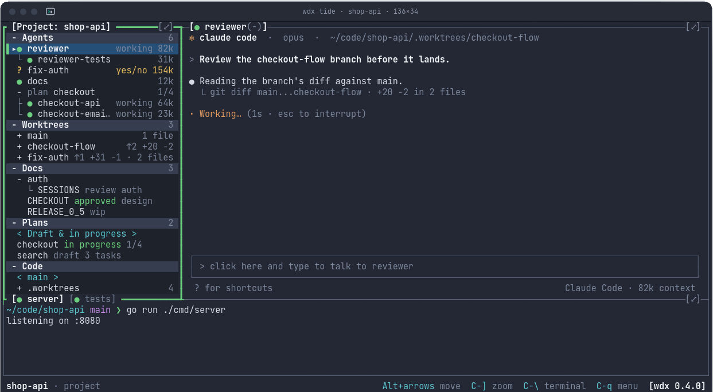

<p align="center">
  <a href="https://srjn45.github.io/wdx/"></a>
</p>

<h1 align="center">wdx</h1>

<p align="center"><b>Run a team of AI coding agents from one terminal.</b></p>

<p align="center">
  <a href="https://srjn45.github.io/wdx/">Website</a> ·
  <a href="https://srjn45.github.io/wdx/docs/">Docs</a> ·
  <a href="https://github.com/srjn45/wdx/releases">Releases</a>
</p>

<p align="center">
  <a href="https://github.com/srjn45/wdx/releases/latest"></a>
  <a href="https://github.com/srjn45/wdx/actions/workflows/ci.yml"></a>
  <a href="LICENSE"></a>
  <a href="https://srjn45.github.io/wdx/docs/"></a>
</p>

<p align="center">📖 Full documentation: <a href="https://srjn45.github.io/wdx/docs/"><b>srjn45.github.io/wdx</b></a></p>

## What is wdx?

wdx lets you run several AI coding agents (Claude Code, Codex, Cursor, Antigravity) on your own machine at the same time, and keep track of them all.

- Each agent keeps running after you close your terminal.
- Each agent can work on its own branch, in its own git worktree, so agents never edit the same files.
- You can see which agents are working, which are done, and which are waiting for an answer from you.
- When an agent is finished, you read its diff and merge its work with one command.

All of this works from the command line, or from **TIDE**, wdx's terminal IDE, which shows your agents, their diffs, your docs and your code in one window:

<p align="center"></p>

## Install

wdx runs on Linux and macOS (amd64 or arm64). Install it with:

```sh
curl -fsSL https://raw.githubusercontent.com/srjn45/wdx/main/scripts/install.sh | sh
```

This puts `wdx` in `~/.local/bin`, sets up shell completions, and starts the wdx daemon as a user service, so it runs whenever you are logged in.

You also need **git 2.31 or later**, and at least one AI CLI installed and logged in, such as `claude` or `codex`. See [Install](https://srjn45.github.io/wdx/docs/start/install/) for the optional extras, updating, and uninstalling.

## Quick start

Open a repository you already have as a wdx project, start two agents, and look at them:

```sh
wdx project open --local ~/code/api
cd ~/code/api
wdx agent create --name reviewer --prompt "review the open changes"
wdx agent create --name fix-auth --worktree fix-auth --aca codex --prompt "fix the session expiry bug"
wdx agent list
wdx tide
```

What these do:

1. `wdx project open` registers the repository with wdx.
2. The first `wdx agent create` starts a Claude Code agent in the repository itself.
3. The second starts a Codex agent on a new branch, in the worktree `fix-auth`, so its changes stay apart from yours.
4. `wdx agent list` shows each agent and what it is doing.
5. `wdx tide` opens TIDE, where you can talk to the agents and read their diffs.

The [Quickstart](https://srjn45.github.io/wdx/docs/start/quickstart/) goes further: talking to an agent, reading its diff, and merging its work. Every command also has `--help`, and `--json` for scripts.

## Documentation

Everything else is on the website, **<https://srjn45.github.io/wdx/>**, built from [`site/`](site/) and published with GitHub Pages whenever it changes on `main` and after each release:

- [What is wdx](https://srjn45.github.io/wdx/docs/start/what-is-wdx/) and [its concepts](https://srjn45.github.io/wdx/docs/start/concepts/)
- [Guides](https://srjn45.github.io/wdx/docs/guides/projects/), one per feature: projects, agents, worktrees, docs, plans and the hub
- [TIDE](https://srjn45.github.io/wdx/docs/tide/layout/), the terminal IDE
- [The AI CLIs](https://srjn45.github.io/wdx/docs/acas/): Claude Code, Codex, Cursor and Antigravity compared
- [Scripting with --json](https://srjn45.github.io/wdx/docs/guides/scripting/) and [Working with AI agents](https://srjn45.github.io/wdx/docs/guides/ai-agents/)
- [Running wdx](https://srjn45.github.io/wdx/docs/guides/daemon/): the daemon, settings and updates
- [Architecture](https://srjn45.github.io/wdx/docs/architecture/): how wdx works inside
- [Reference](https://srjn45.github.io/wdx/docs/reference/cli/): every command, setting and error code
- [Roadmap](https://srjn45.github.io/wdx/docs/project/roadmap/) and [FAQ](https://srjn45.github.io/wdx/docs/project/faq/)

## Building from source

You need Go (the version in [`go.mod`](go.mod)), git and make, on Linux or macOS.

```sh
git clone https://github.com/srjn45/wdx
cd wdx
make build          # builds bin/wdx
```

To try the wdx you built without touching your installed one, give it a home of its own:

```sh
export WDX_HOME=/tmp/wdx-dev
bin/wdx daemon start
bin/wdx project open --local .
```

## Running the tests

```sh
make test           # every test, with the race detector, as CI runs them
make check          # linters, go vet, vulnerability check, notices, commit messages
```

`make check` downloads the linters it needs into `bin/` the first time. Tests use a real SQLite database, real git and real terminals, all in temporary directories, so they never touch your own `~/.wdx`.

The website lives in [`site/`](site/) and needs Node 22.23 or later:

```sh
make site-dev       # serves the site at http://localhost:4321/wdx/ as you edit
make site           # installs, tests and builds it, as CI does
```

## Contributing

Issues and ideas are welcome. Design comes before code here: open an issue describing the problem first, agree on a design, then send a pull request for one agreed step, with its tests and docs. Run `make check && make test` before you push.

- [CONTRIBUTING.md](CONTRIBUTING.md) is the starting point; the [contribution guide](https://srjn45.github.io/wdx/docs/project/contributing/) explains the workflow, licensing, and AI-assisted contributions.
- [`AGENTS.md`](AGENTS.md) has the rules the code follows, for people and AI agents alike.
- [`docs/`](docs/) has a design file for each part of wdx.
- Commit messages follow [Conventional Commits](https://www.conventionalcommits.org/) (`feat:`, `fix:`, `docs:`, …); releases and the changelog are made from them.

## Security and privacy

Read the [security policy](SECURITY.md) for reporting vulnerabilities and the [Privacy and data](https://srjn45.github.io/wdx/docs/project/privacy/) page for local storage, telemetry, AI services, and optional hub uploads.

## Status

wdx is a personal side project, built for the maintainer's own use and shared publicly because it may be useful to others. Maintenance and support are provided on a volunteer basis. There are no guaranteed response times, support commitments, or promises of continued development.

You are responsible for deciding whether wdx suits your needs, reviewing the actions of agents you run, and protecting your credentials and data. The optional hub is self-hosted: its operator manages its deployment and data.

wdx has had stable releases since 0.4.0, with dev releases in between for those who want new features early. The [changelog](https://srjn45.github.io/wdx/docs/reference/changelog/) lists what each release brought. wdx replaces [warden](https://github.com/srjn45/warden), which is now deprecated.

## License

Apache License 2.0. See [LICENSE](LICENSE) and [NOTICE](NOTICE). The licenses of the Go modules wdx is built with are in [THIRD-PARTY-NOTICES.md](THIRD-PARTY-NOTICES.md).

wdx is provided without warranties, subject to the warranty disclaimer and limitations of liability in sections 7 and 8 of the Apache License 2.0. These provisions apply subject to applicable law.
